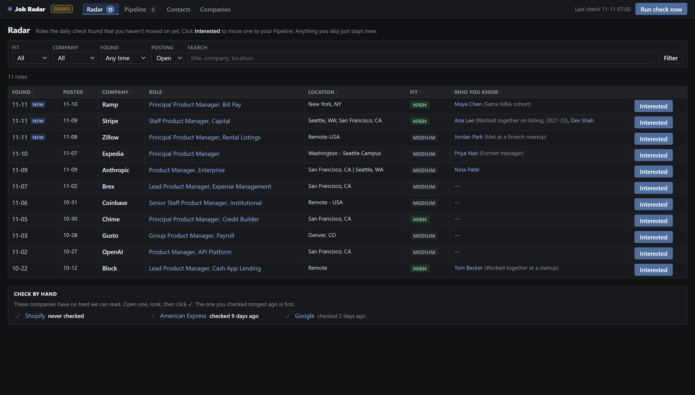
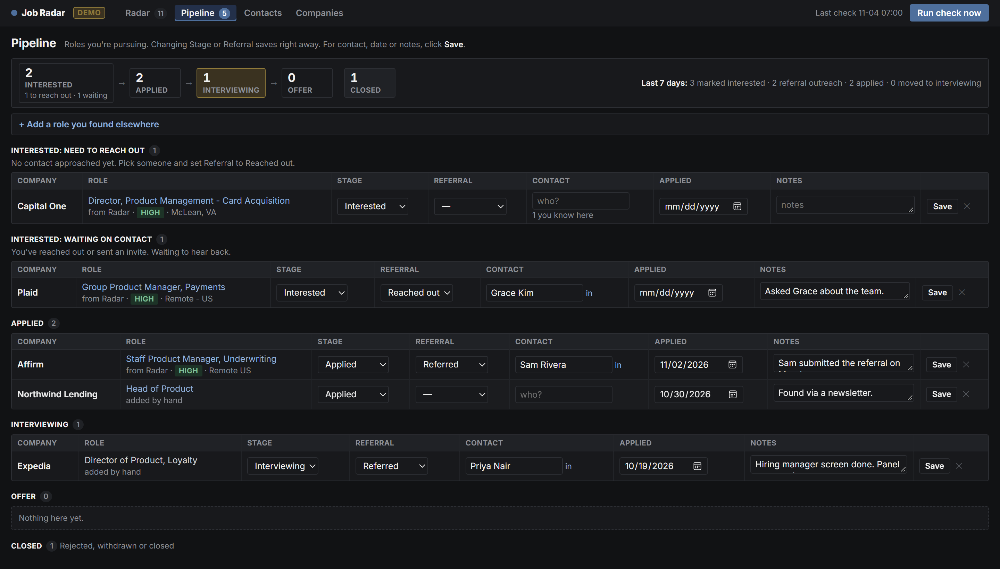

# Job Radar

**A local job-search radar for senior roles.** Once a day it reads the public careers feeds of the companies you care about, keeps the roles that match your level and location, and shows each one next to the people you know there. A built-in pipeline tracks what you've applied to and who's referring you.

Everything runs on your own machine. There are no accounts, no cloud services and no LinkedIn scraping.



## Why

Job alerts on the big boards are noisy: they miss roles on company sites, can't tell "Staff" from "Senior", and know nothing about your network. Most companies publish every opening through a public JSON feed (Greenhouse, Ashby, Lever, Workday). Job Radar reads those feeds directly, so you see a role the day it's posted, filtered the way you'd filter it yourself.

## Features

- **Daily check of 5 careers systems:** Greenhouse, Ashby, Lever, Workday and Amazon, plus a "check by hand" list for companies without a feed.
- **Filtering:** role keywords, seniority, excluded titles, US-only, preferred locations, and a posting-age limit. Roles in your domain are tagged **High** fit.
- **Who you know:** import your LinkedIn `Connections.csv` and every role shows your contacts at that company, with your own notes on how you know them.
- **Pipeline:** Interested → Applied → Interviewing → Offer, with a separate referral track (Reached out / Invite sent / Referred) and weekly progress counts.
- **Self-maintaining:** add a company to your Pipeline and Job Radar looks for its jobs feed and starts tracking it.
- **Safe to re-run:** checks never create duplicates and never overwrite anything you've typed. A role that disappears from its feed is marked Closed.



## Quick start

You need [Python 3.10+](https://www.python.org/downloads/) and git.

```sh
git clone https://github.com/nipun89/job-radar.git
cd job-radar
./setup.sh                                                  # macOS / Linux
powershell -ExecutionPolicy Bypass -File .\setup.ps1        # Windows
```

Setup creates a virtual environment, installs four packages, creates your `config.yaml` and database, and offers to run the check every day at 7:00am. Then start the dashboard:

```sh
.venv/bin/python -m radar serve          # macOS / Linux
.venv\Scripts\python -m radar serve      # Windows (or double-click "Job Radar.bat")
```

It opens at http://localhost:5050. Click **Run check now** for your first results.

**Just want to look around?** `python -m radar demo` opens the app with made-up data on port 5051. Demo data lives in `data/demo/` and never touches your own.

## Commands

| Command | What it does |
|---|---|
| `python -m radar setup` | First run: create `config.yaml` and the database, offer a daily schedule |
| `python -m radar serve` | Open the dashboard (`--port`, `--no-browser`) |
| `python -m radar check` | Fetch every company now (what the schedule runs) |
| `python -m radar schedule [HH:MM]` | Run the check daily: Task Scheduler on Windows, launchd on macOS, cron on Linux |
| `python -m radar schedule --remove` | Stop the daily check |
| `python -m radar demo` | Try it with sample data (`--reset` to start over) |

Use the virtual environment's Python (`.venv/bin/python` or `.venv\Scripts\python`), or activate it first.

## Make it yours: `config.yaml`

The defaults look for senior product management roles in fintech. Change the keywords to suit any role:

```yaml
preferences:
  role_keywords: [software engineer, backend engineer]
  seniority_keywords: [staff, principal]
  domain_keywords: [payments, infrastructure]    # any hit = "High" fit
  preferred_locations: [Seattle, Remote]
```

**Titles without a level.** Many companies post a plain "Product Manager" and decide the level after interviews. `min_pay_without_seniority: 250000` keeps such a role anyway when its stated pay range reaches that much (read from the feed, or from the posting's page for Greenhouse and Workday). Titles that state a lower level, listed in `lower_level_keywords` (e.g. Senior), never qualify.

**Adding a company.** Dashboard → Companies → **+ Add a company**. Type the name and, ideally, paste a link to one of its job postings (or its careers page). **Check** finds its public jobs feed and fetches it once, showing how many postings it has and how many match your filters; **Add** then writes the line to `config.yaml` for you.

To add one by hand instead, open any job on the company's site and look at the link:

| Job link looks like | Add this line under `companies:` |
|---|---|
| `boards.greenhouse.io/acme/jobs/123` | `- {name: Acme, ats: greenhouse, board: acme, match: [Acme]}` |
| `jobs.ashbyhq.com/acme/...` | `- {name: Acme, ats: ashby, board: acme, match: [Acme]}` |
| `jobs.lever.co/acme/...` | `- {name: Acme, ats: lever, board: acme, match: [Acme]}` |
| `acme.wd5.myworkdayjobs.com/External/...` | `- {name: Acme, ats: workday, board: acme\|wd5\|External, match: [Acme]}` |
| anything else | `- {name: Acme, ats: manual, url: https://acme.com/careers, match: [Acme]}` |

`match` lists the employer names LinkedIn might show for your contacts there (e.g. `[Block, Square, Cash App]`). Per-company options are `paused`, `exclude`, `skip_seniority` and `only_contacts`; `config.example.yaml` explains each one.

**Optional hook:** `after_check: <command>` at the top level runs a command after each `python -m radar check` (including the scheduled one), for example a script that backs up `data/jobs.db`. A command starting with `python` uses Job Radar's own Python.

## Your LinkedIn contacts

1. LinkedIn → Settings & Privacy → Data privacy → Get a copy of your data → **Connections**.
2. Dashboard → Contacts → **+ Add contacts** → choose the file → **Upload & import**. Re-upload any time; your notes are kept.

You can also add people one at a time there (name, company, LinkedIn profile link).

## How it works

```
config.yaml ─► fetchers.py ─► filters.py ─► SQLite (data/jobs.db) ◄─► Flask app (app.py + templates/)
               one function     title, level,     jobs, pipeline,         plain HTML forms,
               per careers      location, fit     contacts, runs          no JavaScript framework
               system
```

| File | Role |
|---|---|
| `radar/fetchers.py` | One function per careers system; each returns `{id, title, location, url, posted}` |
| `radar/filters.py` | Whole-word keyword rules, US/non-US location logic, High/Medium fit |
| `radar/run.py` | The check: fetch → filter → insert new → mark closed → log. One broken feed never stops the run |
| `radar/tracking.py` | Finds jobs feeds for Pipeline companies and appends them to `config.yaml` without rewriting your comments |
| `radar/contacts.py` | LinkedIn CSV import and employer-name matching ("Block" matches "Square", not "Blockchain Capital") |
| `radar/pipeline.py` | Pipeline stages, referral track, and a dated event log for progress stats |
| `app.py` | Flask routes: one short function per page or button |

**Design choices**
- **Public feeds only.** It reads the JSON feeds companies publish for their own careers pages, follows robots.txt (which is why Google careers is check-by-hand), and never scrapes LinkedIn.
- **Your edits are yours.** The automated check only inserts new roles and updates open/closed. It never writes to your pipeline, notes or contact annotations, and the tests enforce this.
- **Boring tech.** Python, SQLite, Flask and server-rendered HTML. No build step, no JavaScript framework, four dependencies.

## Tests

```sh
python -m pytest
```

Tests run against throwaway databases and never touch the network. CI runs them on Windows, macOS and Linux.

## Background

Job Radar started as a written spec handed to [Claude Code](https://claude.com/claude-code) ([docs/original-spec.md](docs/original-spec.md)), then grew through daily use: Streamlit gave way to plain Flask and HTML, the status column became a full pipeline, and companies began tracking themselves.

## License

MIT
